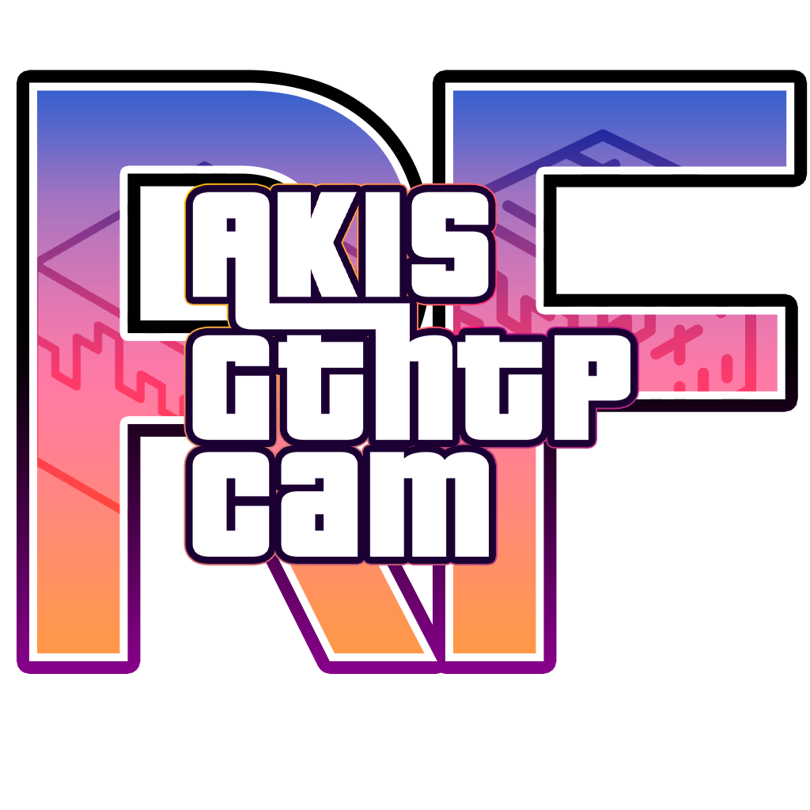
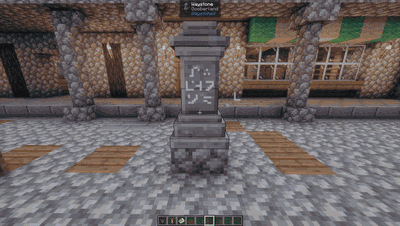

# Aki's Grand Theft Neo Teleport Cam Reforged

  

**[Product of Achilleus](https://linktr.ee/achilleus_)** — NeoForge port and maintenance by [Achilleus (Achilleus-1)](https://github.com/Achilleus-1).

Unofficial Minecraft mod; not approved by or affiliated with Mojang or Microsoft.

Cinematic teleport transitions. The camera holds above the destination until nearby chunks within the effective render distance finish loading and terrain rendering settles, then resumes the zoom-in. Settings: NeoForge Mods screen or `/gtp config`. Uses Minecraft sound replacements.

The loading hold runs entirely on your client, including when playing on a server without this mod. It follows the server's view-distance limit. Additional rendering mods use a longer, conservative settling period because their background terrain work may not expose an exact completion signal. Press **Escape** during a loading hold to restore normal camera control.

## Demo

## Installation

For **Minecraft 1.21.1**, **NeoForge 21.1.255**, and **Java 21**. Download `akis-grand-theft-neo-teleport-cam-reforged-1.21.1-1.0.0-neoforge.11.jar` from [Releases](https://github.com/Achilleus-1/Akis-GrandTheftNeoTeleportCam-Reforged/releases/latest) and place it in your `mods` folder. Remove older copies first.

## Multiplayer

Install the mod on each player client that should display the camera sequence. With
the mod also installed on a NeoForge server, the server starts the sequence on each
player actually being teleported. `/tp Receiver Issuer` and `/tp Receiver ~ ~ ~`
animate Receiver. Group selectors follow the players the server resolves.

On a server without the mod, self teleport commands still support local previews.
An affected modded client can also detect incoming position jumps over three blocks
and live dimension transfers. Vanilla position packets also represent movement
corrections, so this fallback deliberately ignores smaller changes. The server
integration provides precise recipient routing for teleports at every distance.

## Development

Source code is in `src/main/java/`. Mod resources, logos, translations, and metadata are in `src/main/resources/`. Existing internal IDs and configuration paths are preserved.

Build with a Java 21 JDK: `./gradlew build` on Linux/macOS or `.\gradlew.bat build` on Windows. The installable JAR is written to `build/libs/`.

Launch the development client with `./gradlew runClient` or `.\gradlew.bat runClient`. Mod information and Minecraft/NeoForge versions are configured in `gradle.properties`. GitHub Actions checks the build on pushes and pull requests.

## Development and reuse

See [DEVELOPMENT.md](DEVELOPMENT.md) for reproducible checks and known archival dependencies, [CONTRIBUTING.md](CONTRIBUTING.md) for contribution guidance, and [SECURITY.md](SECURITY.md) for private reports.

[Branding assets](BRANDING.md) include the mod icon, original cover, and GitHub social preview.

## License and credits

Based on [Grand Teleport](https://github.com/hookuru/GrandTeleport) by **hookuru_**.

**MIT** — see [LICENSE](LICENSE) and [LEGAL.md](LEGAL.md).

Reference credits: [CREDITS.md](src/main/resources/CREDITS.md). Original ZapSplat audio is excluded.
